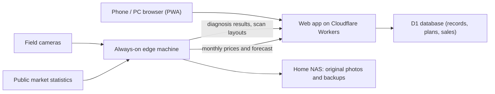
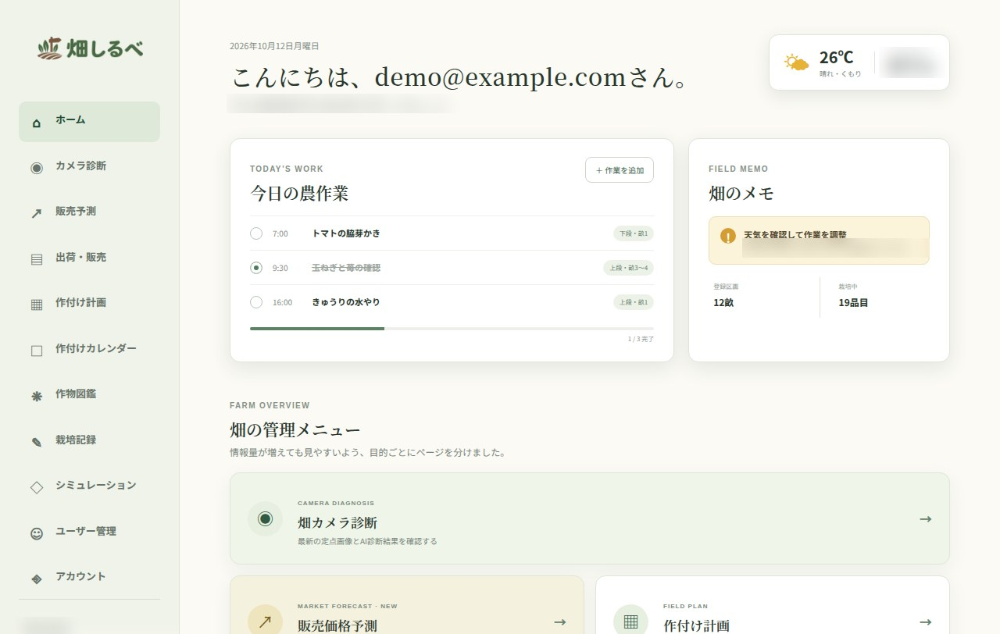
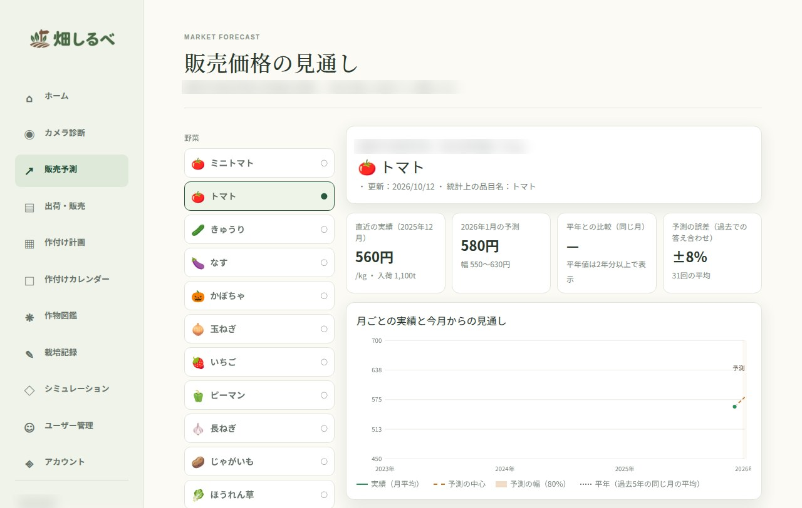
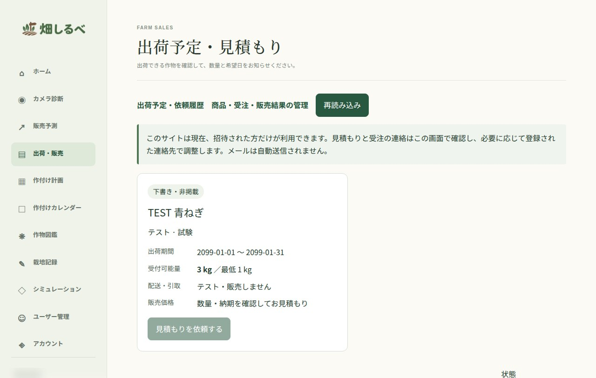

# Hatake Shirube (畑しるべ)

> Working name; trademark and domain checks pending. *Hatake shirube* means "a guide for the field": the place a small farm keeps what it sees, plants, records and sells.

**One line:** a web app for a small family farm that brings camera checks, planting plans, cultivation records, a market-price outlook and invite-only sales into one place, so the farm runs on records instead of memory.

## The problem
A small farm's knowledge lives in a notebook, a phone gallery and someone's head. What was planted in which bed, when it was last watered, whether a leaf problem is spreading, and what the crop will fetch at market are all answered from memory. That does not scale past one person, and nothing is left to learn from next season.

## What it does
- **Camera diagnosis:** fixed cameras photograph the field on a schedule; an AI check flags what may need attention. A person looks at the photo before acting.
- **Planting plan:** a field map built from a 3D scan; dragging a crop icon onto a bed records what was planted where and in which season.
- **Planting calendar and daily work:** what to do today, by bed.
- **Cultivation records:** watering, fertilizing and observations per bed, searchable by field.
- **Crop guide:** a per-crop reference with example photos.
- **Market-price outlook:** monthly wholesale prices from public statistics, with a forecast range and the forecast's past error shown next to it.
- **Sales:** invite-only listings, quote requests and order tracking. Nothing is sold automatically; no email is sent automatically.
- **Roles:** family members, administrators and invited buyers see different pages.

## How it is built

Next.js-compatible app (vinext) on Cloudflare Workers with D1 and Drizzle. Camera capture, diagnosis, market-data collection and scan analysis run on a small always-on machine at home; original photos stay on a home NAS.

## Status
| Verified | How |
|---|---|
| Calendar, crop guide, market, planting plan, records, sales, export, sign-in, roles, privacy, simulation and photo flows | 13 of 14 integration test suites passed against a local copy on 2026-10-12 |
| Not verified | |
| Field-scan layout (14th suite) | failed on the test machine because a Python dependency (numpy) was missing there; not a finding about the app |
| Forecast accuracy | the screenshot shows test data; no accuracy claim is made |
| Diagnosis quality | not measured |
| Paid service, multiple farms | planned; the app is used by one family farm today |

## Screens

*Home. Data is test data; location text is blurred.*

*Market-price outlook. Prices are test data from the integration tests, not real market values; the market name is blurred.*

*Sales. The listing is a test item ("TEST").*

## Where it is going
The same records that run the farm can be published as machine-readable product data, so that buyers' AI agents can find "this week's harvest, near me, grown this way" and request it, with the farmer approving every sale. That is the seller side of the Agent Commerce work.

*Source is private and can be shared on request when we discuss a project. Part of [Happy AI Garage](https://github.com/johnknash2025).*
